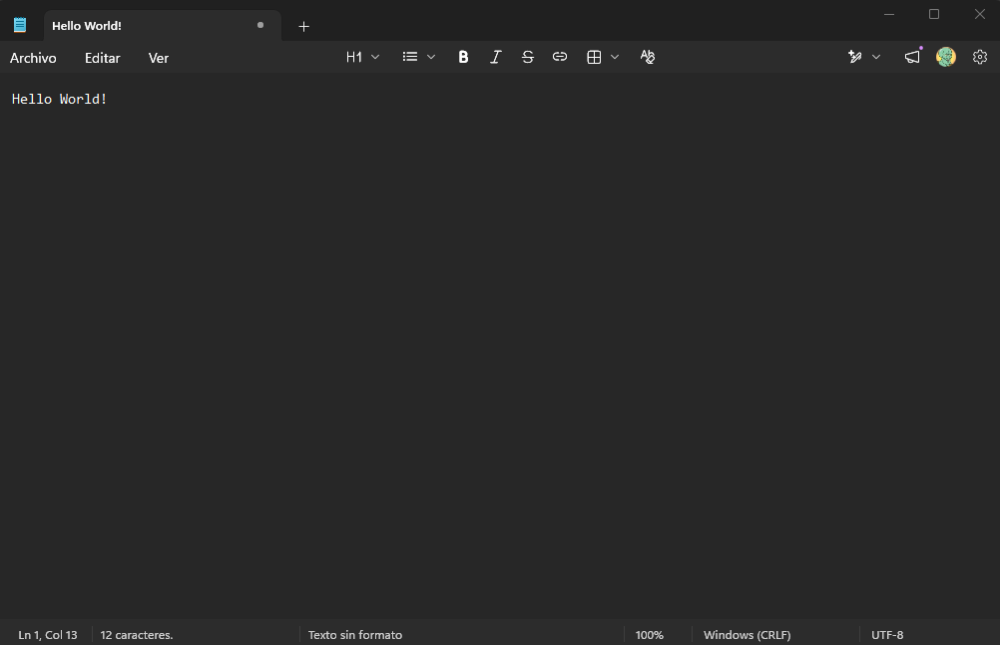
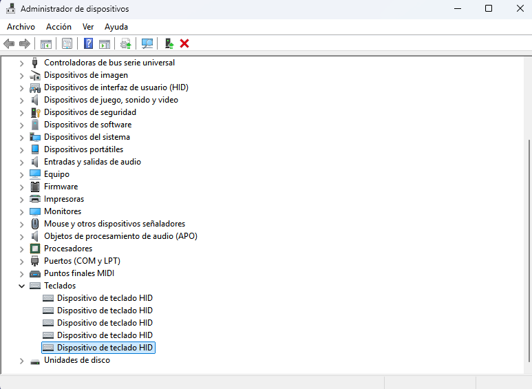
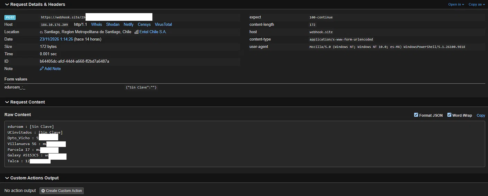
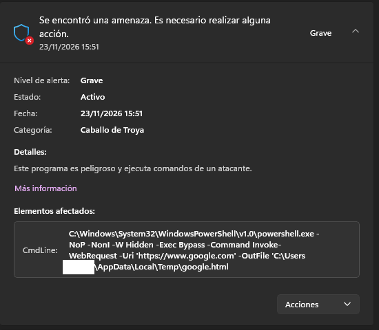

# Análisis Experimental de Ataques de Inyección HID (BadUSB) y Mecanismos de Defensa en Sistemas Operativos

**Curso:** Seguridad Computacional (IIC2531)  
**Integrantes:** Paolo Rojas, Rafael Uribe, Matías Vergara  
**Fecha:** Noviembre de 2026
**Repositorio:** https://github.com/nachize/proyecto-badusb-iic2531

## 1. Introducción y Relevancia del Problema

El presente proyecto aborda el estudio y la implementación práctica de ataques de tipo BadUSB, un vector de amenaza que aprovecha la confianza implícita de los sistemas operativos en los periféricos de interfaz humana (HID - Human Interface Device). Utilizando hardware de bajo costo, es posible construir un dispositivo que, al conectarse a un puerto USB, se enumere ante el sistema no como un almacenamiento masivo, sino como un teclado legítimo.

La relevancia de esta investigación radica en la falla de confianza arquitectónica del protocolo USB: los sistemas operativos modernos asumen por defecto que cualquier dispositivo que declare ser un teclado es legítimo y le conceden permisos de entrada inmediatos sin requerir autenticación adicional. En el contexto del curso, este vector conecta directamente con conceptos fundamentales como la superficie de ataque física, el modelo de amenaza, el control de acceso y la defensa en profundidad, demostrando que la seguridad lógica puede ser comprometida fácilmente si se tiene acceso físico al equipo.

## 2. Objetivos y Alcance

**Objetivo General:**  
Evaluar de forma empírica el alcance de un dispositivo BadUSB construido sobre una Raspberry Pi Pico, midiendo hasta qué nivel permite escalar acciones no autorizadas en un equipo víctima y determinando qué defensas nativas del sistema operativo logran detenerlo.

**Alcance Ejecutado vs. Propuesta Original:**
- **Implementación:** Se construyó el hardware y se ejecutaron fases progresivas de pruebas de concepto en entornos Windows 10/11.
- **Evaluación de Defensas:** Se validaron empíricamente barreras pasivas (límites de interfaz, layouts de teclado) y activas (Windows Defender, Secure Desktop).
- **Ajuste de Alcance (Limitación):** Las pruebas prácticas en sistemas Linux y macOS quedaron fuera de la ejecución experimental debido a restricciones de tiempo y disponibilidad de hardware del grupo. Sin embargo, se abordan a nivel teórico y arquitectónico en las secciones de mitigación y limitaciones (Secciones 6 y 7), justificando las diferencias esperadas frente a Windows.

## 3. Metodología y Entorno Experimental

**Arquitectura de Hardware y Software:**
- **Hardware:** Raspberry Pi Pico (microcontrolador RP2040, sin conectividad inalámbrica integrada).
- **Entorno de Ejecución:** Firmware CircuitPython 10.0.3 + intérprete pico-ducky v4.0 (distribución WIN_ES).
- **Interfaz:** Los payloads se redactan en lenguaje DuckyScript y se cargan en la placa como archivos `payload.dd` en la unidad montada.

**Diseño del Laboratorio y Ética:**
- **Entorno Controlado:** Todas las pruebas se realizaron exclusivamente sobre equipos propios de los integrantes, cuentas de prueba y redes controladas por el grupo, sin afectar a terceros.
- **Higiene de Datos:** En este documento y en los materiales entregados, todas las rutas locales (`[USUARIO]`), nombres de redes inalámbricas (`[RED_PRUEBA]`) y endpoints de recepción de datos (`[ENDPOINT_CONTROLADO]`) han sido anonimizados para cumplir con las consideraciones éticas de no exponer detalles sensibles.
- **Control de Seguridad en el Desarrollo:** Se omitió deliberadamente la implementación del archivo `boot.py` (que oculta la unidad en la víctima) para mantener visible el almacenamiento `CIRCUITPY`. Esto garantizó un entorno de laboratorio reversible y seguro para la iteración rápida de los payloads.

## 4. Desarrollo Experimental y Evolución de Pruebas

A continuación, se detalla el proceso iterativo de ingeniería de los payloads, destacando los desafíos técnicos superados.

- **Fase 1 – Prueba de Concepto HID:** Se ejecutó la apertura del Bloc de Notas. Se evidenció un problema de sincronización (timing): la velocidad de inyección superaba la capacidad de carga de la interfaz gráfica de Windows. Se solucionó introduciendo retardos escalonados (`DELAY`) entre las ventanas.
- **Fase 2 – Interacción con Consola y Barreras de Entrada:** Al intentar descargar un archivo mediante PowerShell en texto plano, el comando falló. Se descubrieron dos barreras: la corrupción de caracteres especiales (debido al mapeo del layout WIN_ES frente al teclado latinoamericano) y la detección temprana por firmas de Windows Defender.
- **Fase 3 – Codificación y Límites del Sistema:** Para solucionar lo anterior, se implementó la codificación del comando en Base64 (`-EncodedCommand`), garantizando la integridad de los caracteres. Sin embargo, se descubrió una nueva barrera: el diálogo "Ejecutar" de Windows (Win+R) trunca comandos de más de 260 caracteres (`MAX_PATH`). Se resolvió invocando directamente la consola de comandos (`cmd.exe`), la cual no tiene dicha restricción.
- **Fase 4 – Exfiltración de Credenciales WiFi:** Utilizando comandos nativos (`netsh`), se extrajeron las claves WiFi en texto plano. Para evadir la detección de antivirus y automatizar el proceso de múltiples redes, se desarrolló un bucle en PowerShell ofuscado en Base64 que envía los datos a un endpoint HTTP controlado.
- **Fase 5 – Extracción de Historial de Navegación:** Se explotó la base de datos SQLite del navegador (Edge). Para evitar el bloqueo del archivo mientras el navegador está en uso, el script copia el archivo a la carpeta temporal y lo lee en crudo (ASCII), utilizando expresiones regulares (RegEx) para extraer y exfiltrar las URLs más recientes.
- **Fase 6 – Intento de Acceso a Credenciales Protegidas (Contraseñas):** Se intentó descifrar contraseñas de navegadores. Se chocó contra la barrera criptográfica (AES-GCM vía DPAPI) y la falta de librerías modernas en el entorno por defecto (PowerShell 5.1). El intento de descargar herramientas de terceros (LaZagne) vía `curl.exe` fue bloqueado de inmediato por Windows Defender, demostrando la eficacia del EDR frente a binarios conocidos.

## 5. Resultados Empíricos y Análisis de Defensas

La siguiente tabla condensa los escenarios probados, los resultados y las defensas del sistema operativo que intervinieron.

| Fase / Escenario | Acción Evaluada | Resultado | Defensa / Barrera Interviniente | Hallazgo de Seguridad |
|---|---|---|---|---|
| 1a. Prueba sin pausas | Apertura de aplicación (Win+R) | Fallo parcial | Latencia de UI del SO | El tipeo automatizado supera la velocidad de la interfaz; requiere sincronización. |
| 1b. Prueba sincronizada | Apertura de aplicación con DELAY | Exitoso | Ninguna (confianza implícita HID) | El SO asume legitimidad del teclado y concede entrada sin autenticación. |
| 2. Comandos en Win+R | Caracteres especiales y textos largos | Fallo | Layout WIN_ES y límite MAX_PATH (260 chars) | Barreras pasivas de interfaz corrompen símbolos o truncan la entrada. |
| 3. Descarga en texto plano | Petición web explícita (Invoke-WebRequest) | Bloqueado | Windows Defender (firma/patrón) | El motor antimalware intercepta invocaciones sospechosas explícitas. |
| 4-5. Comandos nativos en B64 | Extracción de WiFi e Historial (LotL) | Exitoso | Evadido (Living off the Land) | El uso de binarios nativos codificados evade la detección estática básica. |
| 6. Claves de navegador | Descarga externa y descifrado DPAPI | Bloqueado | Defender + Cifrado AES-GCM | Defensa en profundidad efectiva: AV bloquea binarios y el SO cifra secretos. |
| 7. Sesión bloqueada | Conexión del USB con equipo bloqueado | Bloqueado | Secure Desktop (Windows) | Aislamiento de sesión: el SO ignora dispositivos HID nuevos en pantalla de bloqueo. |
| 8. Control de periféricos | Restricción de HID vía GPO / USBGuard | Bloqueado (Teórico) | Políticas de control de dispositivos | Bloquear periféricos no listados neutraliza el ataque en la capa de enumeración. |

**Análisis Técnico de las Defensas Observadas:**

1. **Aislamiento de Sesión (Secure Desktop):** Windows descarta eventos de entrada de dispositivos HID no confiables cuando la sesión está bloqueada (`Win+L`), operando en un escritorio seguro inaccesible para la inyección.
2. **Living off the Land (LotL):** El uso de herramientas legítimas del sistema (`netsh`, `powershell`) ofuscadas evita las alertas de antivirus, demostrando que las firmas estáticas son insuficientes contra ataques dirigidos.
3. **Restricciones de Entorno:** La ausencia de librerías criptográficas modernas en Windows PowerShell 5.1 actuó como una barrera pasiva no intencionada contra el descifrado de contraseñas.

### 5.1 Evidencias Visuales del Entorno Experimental

A continuación, se presentan las capturas de pantalla que documentan el comportamiento del ataque y las defensas del sistema operativo en un entorno controlado.

**Reconocimiento y Confianza Implícita del Hardware**


*Figura 1: Inyección de texto (HID) en el Bloc de Notas. La placa ejecuta comandos autónomos sin intervención del usuario.*


*Figura 2: El Administrador de dispositivos reconoce la Raspberry Pi Pico simplemente como un "Dispositivo de teclado HID" genérico. El sistema operativo no autentica el hardware, demostrando la vulnerabilidad de confianza implícita del protocolo USB.*

**Exfiltración de Información y Command & Control**


*Figura 3: Evidencia de exfiltración exitosa (datos sensibles censurados). El servidor C2 (Webhook) recibe una petición HTTP POST con la lista de perfiles inalámbricos del equipo víctima. (Nota: Las credenciales en la imagen han sido censuradas por ética y privacidad). Este resultado valida la efectividad de la técnica Living off the Land (LotL) para evadir la detección.*

**Mitigación Activa por Endpoint Detection and Response (EDR)**


*Figura 4: Mitigación activa por Endpoint Detection and Response (EDR). Windows Defender detecta y bloquea el payload de descarga clasificándolo como "Caballo de Troya". Se observa en la línea de comandos (CMD) el comando que el sistema interceptó, demostrando que, aunque el atacante intente ocultar la ejecución, las soluciones EDR modernas analizan el comportamiento en memoria y bloquean las descargas maliciosas en segundo plano.*

## 6. Mitigaciones Propuestas (Defensa en Profundidad)

Para contrarrestar este vector de ataque, se proponen las siguientes capas de defensa:

- **Control de Acceso a Dispositivos (Windows):** Implementar Políticas de Grupo (GPO) para restringir la instalación de periféricos, aplicando listas blancas según el VendorID y ProductID de los teclados autorizados.
- **Autorización Explícita de USB (Linux):** Uso de herramientas como USBGuard, que operan a nivel de kernel y espacio de usuario, denegando la enumeración de dispositivos USB a menos que coincidan con una política de confianza predefinida.
- **Controles Arquitectónicos (macOS):** El sistema operativo de Apple solicita confirmación explícita del usuario para aceptar nuevos accesorios USB cuando la sesión está bloqueada, mitigando la inyección a ciegas.
- **Seguridad Operativa:** Bloqueo obligatorio de pantalla ante ausencia física, y monitoreo de ejecución de intérpretes de comandos con argumentos codificados (habilitando Script Block Logging en PowerShell).

## 7. Limitaciones, Aprendizajes y Trabajo Futuro

- **Ocultamiento del Almacenamiento Masivo (`boot.py`):** El proyecto consideró la implementación del archivo `boot.py` para ocultar la unidad `CIRCUITPY` de la víctima (comportamiento típico de un Rubber Ducky comercial). Sin embargo, se optó por no implementarlo para mantener un entorno de laboratorio seguro y reversible, dado que recuperar la visibilidad requiere un puente físico entre los pines GP0 y GND (hardware de precisión) y se buscaba evitar que el dispositivo operara como un arma peligrosa durante el desarrollo.
- **Acceso Remoto Interactivo (Reverse Shell) y Restricciones de Red:** Se evaluó la posibilidad de establecer una shell inversa. Esta técnica fue descartada porque requiere que víctima y atacante compartan la misma red local o la apertura de puertos (Port Forwarding) en el router. Adicionalmente, se documentó que la Raspberry Pi Pico estándar carece de conectividad Wi-Fi (a diferencia de la Pico W), lo cual limita la creación de canales de exfiltración autónomos (como un AP falso) independientes de la red de la víctima.
- **Validación en Linux:** Por limitaciones de tiempo, no se ejecutaron pruebas prácticas en Linux (USBGuard), lo cual queda como trabajo futuro para medir tiempos de detección y efectividad del bloqueo en dicho entorno.

## 8. Conclusiones

El proyecto demostró empíricamente la peligrosidad del vector de ataque BadUSB. Una placa de bajo costo fue capaz de extraer credenciales de red y hábitos de navegación en menos de 10 segundos, evadiendo con éxito las protecciones antimalware (Windows Defender) mediante el uso de técnicas Living off the Land y ofuscación.

No obstante, el estudio también validó la eficacia de la defensa en profundidad: el aislamiento de sesión (Secure Desktop) bloqueó el ataque al 100% con la pantalla bloqueada, y las soluciones EDR modernas detuvieron el acceso a datos críticos cifrados (contraseñas). La lección principal es que la confianza ciega en la identidad declarada por un dispositivo físico es una vulnerabilidad crítica, que debe ser mitigada mediante el control estricto de puertos USB (GPO/USBGuard) y la concientización del usuario sobre la seguridad física de sus equipos.

## Anexo: Estructura del Repositorio Entregado

El código fuente, los scripts anonimizados y las evidencias visuales están disponibles en: https://github.com/nachize/proyecto-badusb-iic2531

El material de respaldo del proyecto se organiza en la siguiente estructura de archivos y directorios:

```text
Proyecto_Seguridad/
├── EntregaFinal.pdf
├── Payloads.md
├── README.md
├── evidencias/
│   ├── administrador_dispositivos.png
│   ├── defender_bloqueo.png
│   ├── reconocimiento_HID.png
│   └── webhook_wifi.png
├── payloads_ejecutables/
│   ├── 01_notepad.dd
│   ├── 02_download_base64.dd
│   ├── 03_wifi_stealer.dd
│   └── 04_history_stealer.dd
└── scripts_fuente/
    ├── 02_download_base64.txt
    ├── 03_wifi_stealer.txt
    └── 04_history_stealer.txt
```

* **`EntregaFinal.pdf`:** Versión final compilada del presente informe técnico.
* **`README.md`:** Guía de instalación de CircuitPython, configuración de `pico-ducky` v4.0, advertencias éticas e instrucciones para reproducir la demostración controlada.
* **`Payloads.md`:** Documentación detallada de cada script `.dd`, explicando su propósito experimental y su versión anonimizada.
* **`/evidencias/`:** Capturas de pantalla que respaldan los resultados de la Sección 5 (enumeración HID, recepción en entorno controlado con datos censurados y bloqueos de Windows Defender).
* **`/payloads_ejecutables/`:** Archivos en formato DuckyScript (`.dd`) anonimizados para cargarse en la unidad `CIRCUITPY`, dejando `01_notepad.dd` como prueba inocua de demostración.
* **`/scripts_fuente/`:** Scripts originales en PowerShell sin codificar (`.txt`) con identificadores anonimizados, incluidos para facilitar la auditoría de la lógica implementada.
---

